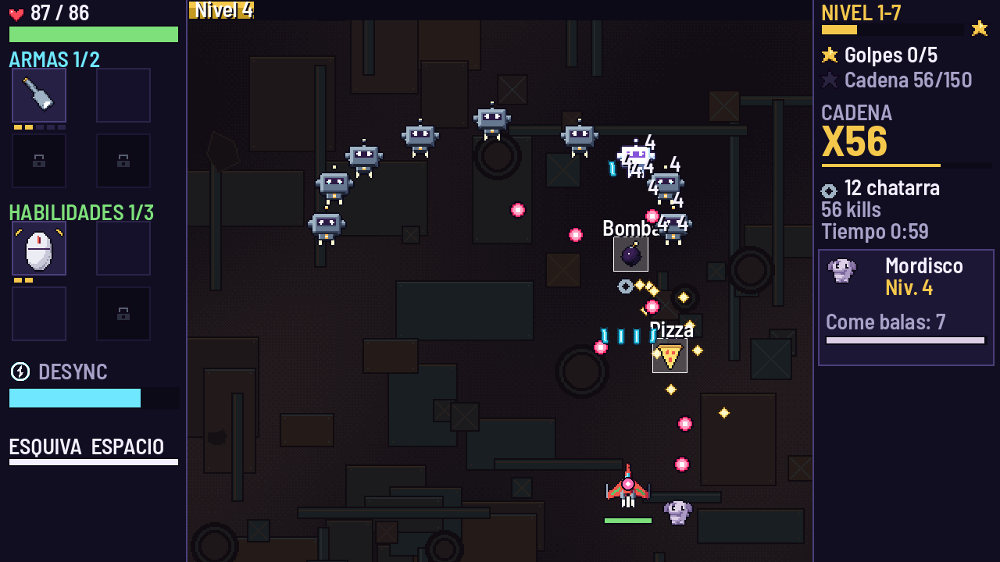
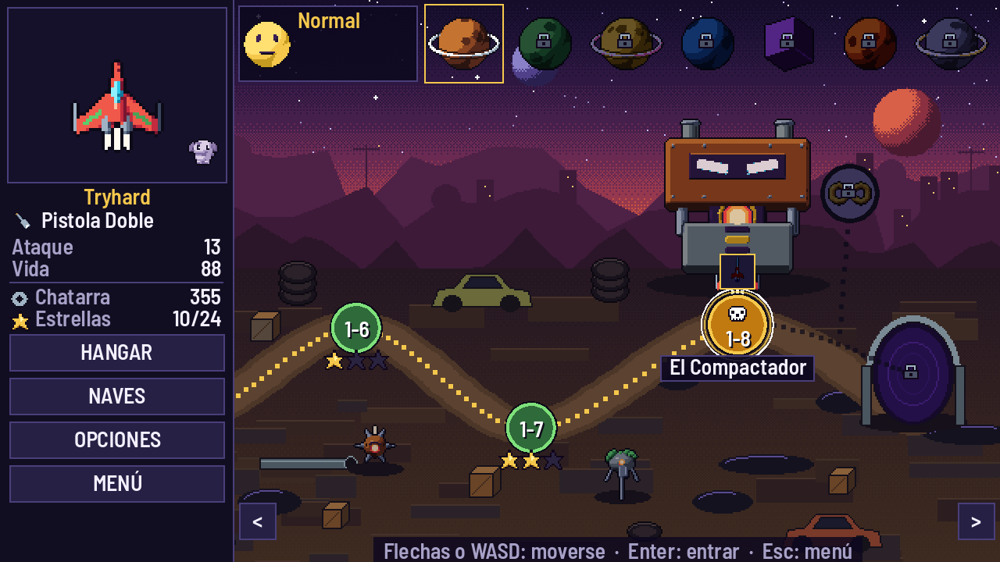
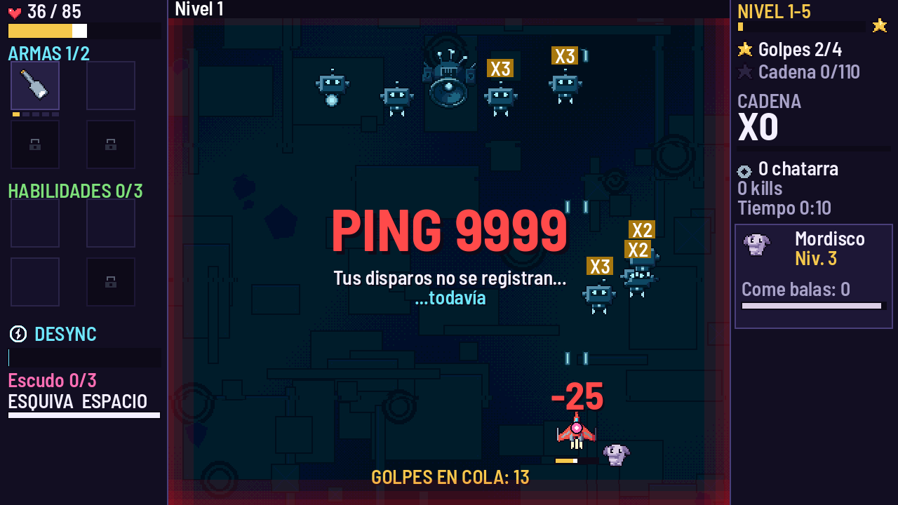
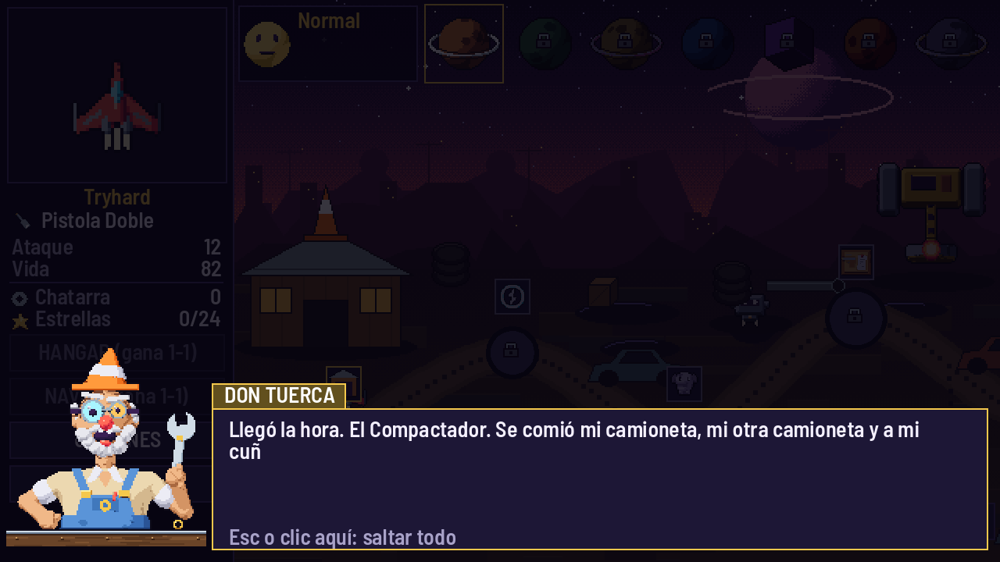
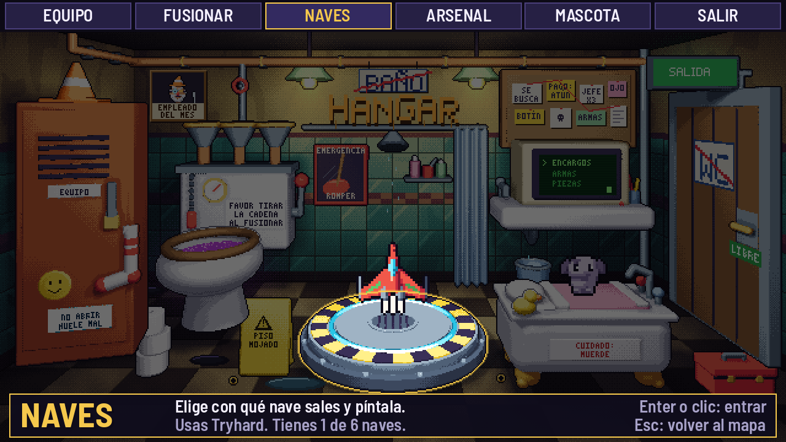

# Calypso

**Un bullet hell con progreso tipo Survivor!.io.** Pilota una nave en un basural espacial, esquiva lluvias de balas, elige armas y habilidades en cada partida, y entre partidas arma tu nave en el Hangar con piezas, fusiones y mascotas. Con humor gamer y un guía chatarrero, Don Tuerca, que habla a la chilena.

**Versión actual: 0.3.0.** Por ahora tiene un mundo completo, con 8 niveles, la Ruleta y el Modo Infinito.



| | |
|---|---|
|  |  |
|  |  |

---

## Jugar

1. Entra a **[Releases](https://github.com/ivanmaxor/Calypso-GM/releases/latest)** y descarga `Calypso-v0.3.0-windows.zip`.
2. Descomprime y abre `Calypso.exe`. No necesita instalación.

**Requisitos mínimos:**
- Windows 10 u 11 de 64 bits;
- tarjeta de video con OpenGL 3.3;
- unos 250 MB libres.

**Dónde quedan las partidas:** `%APPDATA%\Godot\app_userdata\Calypso v2\`. Son 3 ranuras (`partida3_1.json` a `partida3_3.json`) más `global3.json`. Para respaldarlas, copia esa carpeta.

**Controles:** WASD o flechas para moverse, y la nave dispara sola. Shift para ir lento (foco), Espacio para esquivar, X para el Desync y Esc para la pausa. Todo se cambia en Opciones → Teclas, con tecla principal y secundaria. También funciona con mando.

---

## Preparar el entorno para programar

### 1. Godot 4.7.2 (versión exacta)
- Descarga `Godot_v4.7.2-stable_win64.exe.zip` desde [la Release oficial 4.7.2-stable](https://github.com/godotengine/godot/releases/tag/4.7.2-stable) y descomprímelo donde quieras.
- Usa la versión **estándar**, no la "mono" (.NET): el juego está en GDScript.
- Trae dos ejecutables. Las herramientas usan el `_console.exe`, que muestra la salida en la terminal.

### 2. Plantillas de exportación (solo para crear el `.exe`)
- Descarga `Godot_v4.7.2-stable_export_templates.tpz` de la misma Release (~1,3 GB).
- En el editor: **Editor → Manage Export Templates → Install from File** y elige el `.tpz`.
- Quedan en `%APPDATA%\Godot\export_templates\4.7.2.stable\`.

### 3. Clonar el repositorio
```bash
git clone https://github.com/ivanmaxor/Calypso-GM.git
cd Calypso-GM
```
No usa Git LFS: basta un `git clone` normal.

### 4. Abrir y correr el juego
Abre Godot, elige **Import** y selecciona `juego/project.godot`. Con **F5** se corre.

### 5. Herramientas y pruebas
Las pruebas se corren con `herramientas/probar.sh` desde **Git Bash** (viene con [Git para Windows](https://git-scm.com/download/win)). El script busca el motor:
1. en la variable `GODOT`;
2. en `herramientas/godot/` (carpeta ignorada por git, por si quieres dejarlo ahí);
3. en el PATH, como `godot` o `godot4`.

```bash
export GODOT="/c/ruta/a/Godot_v4.7.2-stable_win64_console.exe"   # si no está en las otras dos

bash herramientas/probar.sh import         # importa recursos y muestra errores de compilación
bash herramientas/probar.sh tests          # reglas del juego (7.588 comprobaciones)
bash herramientas/probar.sh flujo          # recorre los menús con teclas y clics simulados (615 pasos)
bash herramientas/probar.sh flujo_hangar   # el Hangar y el Arsenal (189 pasos)
bash herramientas/probar.sh bot 3          # 3 partidas de un bot; agrega "torpe" para el bot malo
bash herramientas/probar.sh campana        # el mundo entero en orden, con el bot
bash herramientas/probar.sh cap <carpeta_absoluta> 60,300 --pantalla=hangar --salir=310   # capturas
```

`tests`, `flujo`, `flujo_hangar`, `bot` y `campana` corren **sin ventana**, así que puedes seguir usando el PC (o jugar) mientras corren. Solo `cap` y los recorridos con carpeta de capturas abren una ventana, **fuera de la pantalla**. Usan sus propios guardados, opciones y teclas, sin tocar los tuyos. Con `CALYPSO_P=<prefijo>` dos pruebas a la vez no se pisan. Más detalles en [memorias/aprendizajes.md](memorias/aprendizajes.md).

**Generadores de arte y audio** (opcional): necesitan Python 3 con `numpy` y `pillow` (`pip install numpy pillow`). Ver [memorias/guia-arte.md](memorias/guia-arte.md). Después de regenerar, `python herramientas/arte/png_sin_cambios.py --restaurar` deja fuera del commit los PNG que solo cambiaron en bytes.

---

## Exportar el ejecutable

```bash
bash herramientas/probar.sh exe            # deja build/Calypso.exe (la carpeta build/ no se sube)
```

Por dentro corre `--export-release "Windows"` con el preset de `juego/export_presets.cfg` (Windows de 64 bits, con todo dentro del `.exe`).

Para probar los menús sobre el `.exe` ya exportado:
```bash
build/Calypso.exe --audio-driver Dummy --fixed-fps 60 -- --pruebas --flujo --guardado=rel --reiniciar
```

Cómo se arma y publica una Release: [memorias/guia-colaboracion.md](memorias/guia-colaboracion.md#versiones-y-releases).

---

## Estructura

```
juego/          proyecto de Godot: nucleo/ (catálogos y autoloads), combate/, pantallas/, pruebas/, arte/, audio/
herramientas/   probar.sh, generadores de arte y audio, inventario
docs/           diseño, investigación, historia, arte, controles y tecnología
memorias/       la memoria viva del proyecto
```

| Memoria | Qué tiene |
|---|---|
| [fases.md](memorias/fases.md) | Qué está hecho, qué sigue (v0.4: pulido y balance) y los Issues |
| [arquitectura.md](memorias/arquitectura.md) | Cómo está hecho y cómo agregar armas, enemigos o niveles |
| [guia-arte.md](memorias/guia-arte.md) | Cómo se hace el arte y cómo hacer arte nuevo que se vea igual |
| [aprendizajes.md](memorias/aprendizajes.md) | Trampas ya resueltas de Godot, de las pruebas y del balance |
| [decisiones.md](memorias/decisiones.md) | Qué se decidió, por qué y qué se descartó |
| [historia.md](memorias/historia.md) | El juego desde el jugador, sin spoilers |
| [inventario.md](memorias/inventario.md) | Armas, habilidades, piezas, enemigos, niveles y desafíos, generado desde el código |
| [session-log.md](memorias/session-log.md) | Qué se hizo en cada sesión y quién |
| [guia-colaboracion.md](memorias/guia-colaboracion.md) | Cómo trabajar juntos sin pisarse |

---

## Colaborar

Resumen:
- cada tarea es un **Issue**, que alguien se asigna antes de empezar;
- **una rama por tarea**, y **Pull Request a `main`** revisado por el otro. Nadie sube directo a `main`;
- antes del PR se corren las pruebas;
- al terminar la sesión se anota en `memorias/session-log.md`.

Detalle en la [guía de colaboración](memorias/guia-colaboracion.md).

**Regla permanente: cero datos personales y cero claves.** Nada de claves, tokens, apellidos, RUT, correos personales, teléfonos, direcciones, rutas con el usuario del PC ni textos dirigidos a una persona. Git se configura con el correo privado de GitHub (`...@users.noreply.github.com`).

---

## Créditos y licencia

- **Juego, arte, efectos y código:** hechos para este proyecto por sus autores.
- **Música:** HoliznaCC0, Komiku y Loyalty Freak Music (CC0), y Scott Buckley (CC-BY 4.0). El detalle, tema por tema, está en [juego/audio/musica/LICENCIAS_MUSICA.txt](juego/audio/musica/LICENCIAS_MUSICA.txt).
- **Letras:** Barlow Semi Condensed y Jersey 10, bajo SIL Open Font License 1.1.
- **Motor:** [Godot Engine](https://godotengine.org), con licencia MIT. Su aviso de licencia va en [juego/LICENCIAS_GODOT.txt](juego/LICENCIAS_GODOT.txt).

Los créditos completos están en [juego/CREDITOS.txt](juego/CREDITOS.txt).

**Licencia:** todos los derechos reservados, salvo el material de terceros, que mantiene su propia licencia. Puedes ver el código y descargar y jugar el juego, pero no reutilizar su código ni su arte. Detalle en [LICENSE.md](LICENSE.md).
